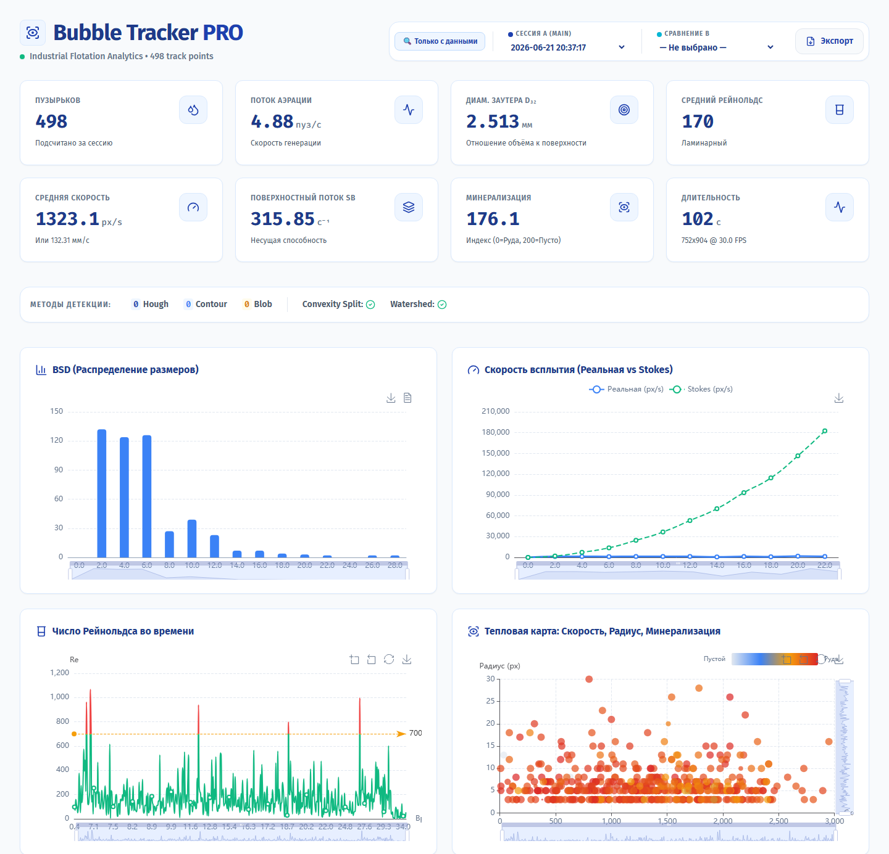

# Bubble Tracker

Считает пузырьки на видео или с камеры. OpenCV находит пузырьки шестиступенчатым конвейером, трекер ведёт каждый и засчитывает ровно один раз, когда тот пересекает линию подсчёта снизу вверх. Живая статистика и видеопоток уходят в веб-дашборд на React.

[](LICENSE)
[](https://github.com/tgKishikaisei/bubble-tracker/actions/workflows/ci.yml)



## Как устроено

- **Трекер** (`bubble_tracker_pro.py`, OpenCV и tkinter). Конвейер детекции: CLAHE, Top-Hat, вычитание фона MOG2, HoughCircles, контуры с проверкой круглости, SimpleBlobDetector; по желанию оптический поток. Скорость предсказывает следующую позицию, поэтому трек не теряется в плотном потоке. Зону детекции, пороги и скорость воспроизведения (0,25×–2×) меняют ползунки прямо во время работы.
- **Результаты.** Сессии сохраняются в `bubble_results/`: `sessions.json`, `sessions.xlsx` с форматированием и тепловые карты. В каждой сессии число пузырьков, средний радиус, скорость потока и зона.
- **API** (`bubble-api/`, FastAPI). Трекер поднимает его сам: статистика по WebSocket, MJPEG-поток, команды `stop` и `reset`, история сессий.
- **Дашборд** (`bubble-dashboard-ui/`, React, ECharts, TanStack Query). Графики в реальном времени, окно с видео, экспорт отчёта в PDF.

Подробное описание параметров и рецепты настройки лежат в [BUBBLE_TRACKER_DOCS.md](BUBBLE_TRACKER_DOCS.md).

## Стек

Python 3.12, OpenCV, NumPy, SciPy, tkinter, openpyxl, FastAPI; React 18, TypeScript, Vite 7, ECharts, Tailwind CSS.

## Запуск

```bash
git clone https://github.com/tgKishikaisei/bubble-tracker.git
cd bubble-tracker
python -m venv venv
venv\Scripts\activate                # Linux и macOS: source venv/bin/activate
pip install -r requirements.txt
python bubble_tracker_pro.py          # выберите видео или камеру в окне
```

Дашборд в режиме разработки:

```bash
cd bubble-dashboard-ui
npm ci
npm run dev                           # http://localhost:5173
```

На Windows оба шага запускает `ЗАПУСТИТЬ_ДАШБОРД.bat`. API и дашборд в Docker (порты открыты только на 127.0.0.1):

```bash
docker compose up -d --build           # дашборд: http://localhost:3000
```

## Тесты

```bash
cd bubble-api
pip install -r requirements.txt pytest httpx
python -m pytest -q
```

## Живая версия

Публичного стенда нет: трекеру нужно видео или камера на вашем компьютере.

## Лицензия

[MIT](LICENSE) © 2026 Behruz Avezmatov
